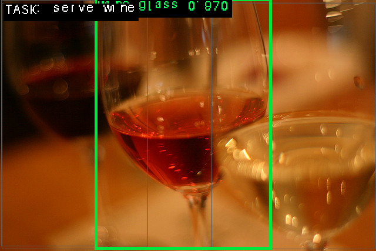
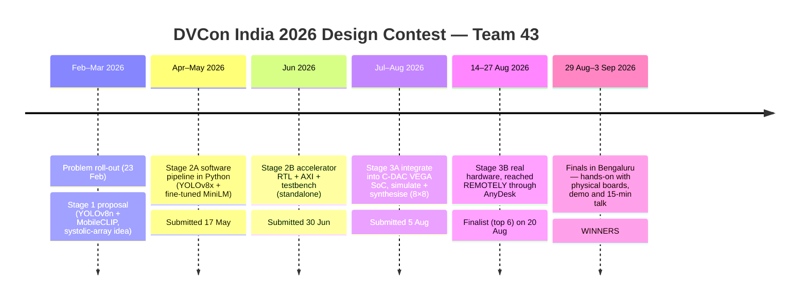
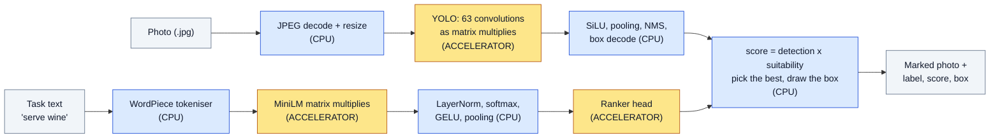
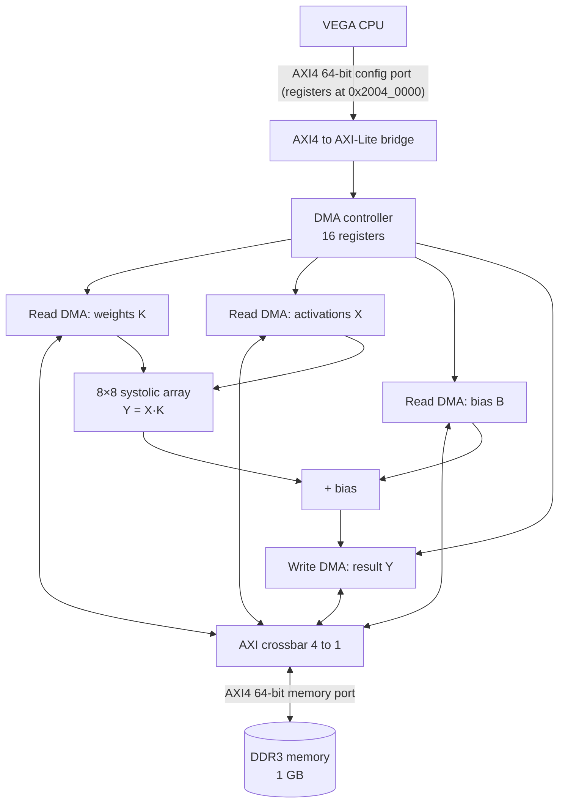

<div align="center">

# Task-Aware Object Selection on a RISC-V FPGA

### 🏆 Winner — DVCon India 2026 Design Contest

**Team 43 · Silicon Syndicate · University of Moratuwa, Sri Lanka 🇱🇰**

*Give the board a photo and a sentence such as "serve wine".
It gives back the same photo with **one** object marked — the object you would actually pick up to do that job.*

Digilent Genesys 2 · AMD/Xilinx Kintex-7 XC7K325T · C-DAC VEGA AS1061 RISC-V @ 50 MHz · custom 8×8 INT8 systolic-array accelerator


</div>

---

## Contents

1. [What we built, in one minute](#1-what-we-built-in-one-minute)
2. [Headline results](#2-headline-results)
3. [The eight-month journey at a glance](#3-the-eight-month-journey-at-a-glance)
4. [How the system works](#4-how-the-system-works)
5. [Repository map](#5-repository-map)
6. [Try it yourself](#6-try-it-yourself)
7. [Documentation index](#7-documentation-index)
8. [What is ours and what is not](#8-what-is-ours-and-what-is-not)
9. [Team, mentors and acknowledgements](#9-team-mentors-and-acknowledgements)
10. [Licence and citation](#10-licence-and-citation)

---

## 1. What we built, in one minute

Most object detectors answer *"what is in this picture?"*. This project answers a harder question: *"which of these things should I use for this task?"*. The right answer changes when the sentence changes, even on the same photo. For "serve wine" the answer is a wine glass if there is one, and a cup if there is not.

This problem is called **task-driven object detection**. It was introduced by Sawatzky et al. at CVPR 2019 together with the **COCO-Tasks** dataset (14 everyday tasks). The DVCon India 2026 Design Contest asked teams to solve it **on an edge device**: a soft RISC-V processor (C-DAC's VEGA AS1061) running on an FPGA board, helped by a hardware accelerator that each team designs.

Our solution has three parts:

| Part | What it is | Where it runs |
|---|---|---|
| **Detector** | YOLOv8n (or YOLOv8s), quantised to 8-bit integers (INT8). It finds every object and gives each one a box and a confidence. | 63 convolution layers on **our accelerator**, the rest on the VEGA CPU |
| **Ranker** | A fine-tuned **MiniLM** sentence model. It reads the task text and each object's class name and scores how well they fit. | All matrix multiplies on **our accelerator**, the rest on the VEGA CPU |
| **Accelerator** | An **8×8 systolic array**: 64 small multiply-add units in a grid, doing 512 INT8 multiply-adds per call. Connected to the CPU through AXI buses and DMA engines. | FPGA fabric, next to the VEGA CPU |

**Everything runs on the board.** The JPEG photo is decoded on the board, both neural networks run on the board, and the final choice is made on the board. The PC only copies files over.

> **Words used on this page.**
> **FPGA** – a chip whose hardware you can re-wire with a file called a *bitstream*.
> **SoC** – "system on chip": CPU + memory controller + buses + peripherals in one design.
> **INT8** – 8-bit whole numbers (−128…127). Using them instead of 32-bit floats makes the maths cheaper.
> **Systolic array** – a grid of multiply-add cells; numbers flow through the grid one cell per clock tick.
> **AXI** – the standard on-chip bus (from Arm) used to connect the CPU, memory and our accelerator.
> **DMA** – a small engine that copies data between memory and the accelerator without the CPU doing it.
> More terms are explained in [docs/glossary.md](docs/glossary.md).

---

## 2. Headline results

All numbers below were **measured on the physical Genesys 2 board** unless marked otherwise.

| What | Result |
|---|---|
| Competition outcome | **Winner** among 6 finalists (12 teams reached the hardware stage; the contest started with 650+ teams from India and Sri Lanka) |
| Accuracy (YOLOv8s INT8, 256 px, COCO-Tasks metric) | **top-1 0.627 · mAP@0.5 0.425** — the GPU reference (Faster R-CNN) reports top-1 0.640 · mAP@0.5 0.409 |
| Ranker alone, on ground-truth boxes | **mAP@0.5 0.648**, picks the right object **94.7 %** of the time |
| End-to-end time for one query | **87.5 s** (YOLOv8n, 256 px, aspect-fitted) on a 50 MHz CPU with no hardware floating point |
| Speed-up from our accelerator | **5.2×** on matrix multiplies, **2.8×** end to end (same binary, only `--sim` changed) |
| Accelerator size | **11,945 LUTs (5.86 %) · 0 DSP · 0 BRAM** (post-route) |
| Timing | 50 MHz system clock met, worst setup slack **+0.556 ns** |
| Host vs board | **bit-identical** outputs, checked on every run by an `fpcheck` fingerprint |

<p align="center">
<br/>
<em>Real board output (Stage 3B, 128 px): task "serve wine" → <b>wine glass</b>, score 0.970.</em>
</p>

The 14-task evidence run on the board (YOLOv8s, 256 px, one photo per task — about 274 s each):

<p align="center"></p>

Details and logs: [results/](results/README.md).

---

## 3. The eight-month journey at a glance



| Stage | What the organisers asked for | What we delivered | Read more |
|---|---|---|---|
| 1 — Proposal | A design proposal | YOLOv8n + MobileCLIP pipeline idea; systolic-array accelerator study | [docs/03](docs/03_stage1_proposal.md) |
| 2A — Software | Working task-aware detection code, 2-page report, video | YOLOv8x + fine-tuned MiniLM in Python, 85.4 % positive top-1 on a 1,000-row test | [docs/04](docs/04_stage2a_software_pipeline.md) |
| 2B — Accelerator | Accelerator + AXI interface + testbench | AXI-stream systolic array with DMA, self-checking testbench | [docs/05](docs/05_stage2b_accelerator.md) |
| 3A — Integration | Put the accelerator inside the VEGA SoC, prove it in simulation, synthesise | 8×8 array, self-checking firmware (`BCSP`), strict VCD analyser, 6.09 % LUTs | [docs/06](docs/06_stage3a_soc_integration.md) |
| 3B — Hardware | Run on the real board (remote lab) | Full pipeline on the board: JPEG → YOLO → MiniLM → answer | [docs/07](docs/07_stage3b_remote_hardware.md) |
| Finals | Hands-on work, demo, 15-min talk in Bengaluru | Live demo on physical boards, talk, Q&A — **Winner** | [docs/08](docs/08_finals_bengaluru.md) |

The full story, with dates, is in [docs/02_journey_timeline.md](docs/02_journey_timeline.md).

---

## 4. How the system works



Blue boxes run on the **VEGA RISC-V CPU** (Linux, 50 MHz); yellow boxes run on **our 8×8 INT8 accelerator** in the FPGA fabric. Everything runs on the Genesys 2 board.

**The rule we used to split the work:** anything that is a large INT8 matrix multiply goes to the accelerator; everything else (non-linear functions, sorting, drawing) stays on the CPU.

**How the accelerator is wired** (simplified):



Each call computes `Y = X·K + B` on 8×8 tiles: X and K are INT8, B and Y are INT32. Longer sums are made by feeding the running result back in as the next "bias", so the hardware does the accumulation.

A deeper walk-through (data path widths, register map, memory map, why 8×8 and not 16×16) is in [docs/09_system_architecture.md](docs/09_system_architecture.md) and the full [technical report](docs/TECHNICAL_REPORT.md).

---

## 5. Repository map

```
.
├── README.md                     ← you are here
├── docs/                         ← the story and the explanations (start with docs/README.md)
│   ├── 01 … 12 *.md              ← stage-by-stage write-ups, architecture, how-to, lessons, references
│   ├── TECHNICAL_REPORT.md       ← our full finals technical report (21 sections)
│   ├── code_guides/              ← line-by-line guides: RTL, firmware, probes, toolchain
│   ├── reports/                  ← Stage 1–3B reports and analyses we wrote during the contest
│   ├── stage2b/                  ← Stage 2B accelerator notes (speed-up model, block diagram spec)
│   ├── archive/stage3a_2x2/      ← our first (2×2) Stage 3A attempt, kept for history
│   └── images/                   ← photos and figures
├── stage2_software_pipeline/     ← Stage 2A: Python pipeline (YOLO + MiniLM), training, MobileCLIP experiment
├── hardware/
│   ├── accelerator_ip/           ← accelerator RTL (SystemVerilog/Verilog) + SoC wrapper Accelerator_Top.v
│   ├── stage3a_simulation/       ← self-checking firmware, golden model, VCD analyser, TCL flows, results
│   ├── reports/                  ← post-route Vivado utilisation and timing reports (board build)
│   └── REBUILD.md                ← how the bitstream was rebuilt in the organiser environment
├── firmware/                     ← the C program that runs on the board (one file, ~2,000 lines)
│   ├── src/ generated/           ← source, JPEG decoder, font, model-shape headers
│   ├── milestones/               ← Milestone A–D programs used during hardware bring-up
│   ├── probes/                   ← small programs that each answer one hardware question
│   ├── scripts/                  ← build, deploy, verify and run scripts used on the board
│   └── prebuilt/                 ← static RISC-V binaries that ran in the finals
├── models/                       ← INT8 model packages (YOLOv8n, YOLOv8s, MiniLM) + vocabulary
├── offline_export/               ← Python tools that turn PyTorch models into the INT8 packages
├── evaluation/                   ← COCO-Tasks accuracy evaluation (mAP@0.5, top-1)
├── results/                      ← board logs (milestones, 14-task run) and output images
└── test_data/                    ← demo input and golden reference outputs
```

---

## 6. Try it yourself

You can run a large part of this project **without any FPGA**. The board program has a `--sim` switch that replaces the accelerator with an exact software copy, so a normal Linux PC (or WSL on Windows) gives the **same answer, bit for bit**, as the board.

```bash
git clone https://github.com/Dulina14/dvcon2026-task-aware-riscv-fpga.git
cd dvcon2026-task-aware-riscv-fpga/firmware
mkdir -p build && cp src/* generated/team43_minilm_layout.h generated/yolov8n/team43_yolo_graph.h build/
cd build
gcc -std=gnu99 -O2 -ffp-contract=off -o pipeline_x86 team43_pipeline.c -lm
./pipeline_x86 --sim --image ../../test_data/input/demo_image.jpg --task "serve wine" \
    --imgsz 256 --rect \
    --yolo   ../../models/team43_yolo_int8.bin \
    --minilm ../../models/team43_minilm_int8.bin \
    --vocab  ../../models/vocab.txt \
    --packed ../../models/team43_minilm_packed.bin \
    --out result.ppm
```

The run header must print `fpcheck: 34800000 3efe65ea be54d74a` — the same line the board prints. On a PC this takes under a second; on the 50 MHz board the same work takes about 90 seconds.

What you can reproduce, and what you need for each level:

| Level | What you need | Guide |
|---|---|---|
| 1. Run the board program on a PC (`--sim`) | gcc, this repo | [docs/10 §2](docs/10_reproduce.md#2-level-1--run-the-board-program-on-a-pc) |
| 2. Run the Python pipeline (Stage 2A) | Python, PyTorch, Ultralytics, a trained MiniLM checkpoint | [docs/10 §3](docs/10_reproduce.md#3-level-2--the-python-pipeline-stage-2a) |
| 3. Re-create the INT8 model packages | Python, PyTorch, the checkpoints | [docs/10 §4](docs/10_reproduce.md#4-level-3--re-create-the-int8-model-packages) |
| 4. Measure accuracy on COCO-Tasks | Python, COCO 2014 + COCO-Tasks datasets | [docs/10 §5](docs/10_reproduce.md#5-level-4--measure-accuracy-on-coco-tasks) |
| 5. Simulate / synthesise the accelerator in the SoC | Vivado, **the organiser's VEGA SoC kit** (not public) | [docs/10 §6](docs/10_reproduce.md#6-level-5--simulate-and-synthesise-the-accelerator-inside-the-soc) |
| 6. Run on a real Genesys 2 board | Board + organiser VEGA bitstream/Linux image | [docs/10 §7](docs/10_reproduce.md#7-level-6--run-on-a-real-genesys-2-board) |

---

## 7. Documentation index

| # | Document | What you will learn |
|---|---|---|
| 01 | [The challenge](docs/01_the_challenge.md) | The contest, the problem, the reference paper, the platform, the rules |
| 02 | [Journey timeline](docs/02_journey_timeline.md) | Every stage with dates — from roll-out to the award |
| 03 | [Stage 1 — Proposal](docs/03_stage1_proposal.md) | First idea, background research, systolic-array study |
| 04 | [Stage 2A — Software pipeline](docs/04_stage2a_software_pipeline.md) | YOLO + MiniLM in Python, training on Colab, results, what we dropped |
| 05 | [Stage 2B — Accelerator](docs/05_stage2b_accelerator.md) | The AXI-stream systolic array and its standalone testbench |
| 06 | [Stage 3A — SoC integration](docs/06_stage3a_soc_integration.md) | Fitting into the VEGA SoC, self-checking simulation, synthesis |
| 07 | [Stage 3B — Remote hardware](docs/07_stage3b_remote_hardware.md) | **Working on the board through AnyDesk**, bring-up milestones A–D |
| 08 | [Finals in Bengaluru](docs/08_finals_bengaluru.md) | **Hands-on with physical boards**, the demo, the talk, the win |
| 09 | [System architecture](docs/09_system_architecture.md) | Hardware/software split, data path, register and memory maps |
| 10 | [Reproduce it](docs/10_reproduce.md) | Step-by-step instructions at six levels |
| 11 | [Lessons learned](docs/11_lessons_learned.md) | What cost us days, and advice for future teams |
| 12 | [References and resources](docs/12_references.md) | Papers, datasets, tools, IP, documentation we used |
| — | [Technical report](docs/TECHNICAL_REPORT.md) | The complete engineering write-up (measurements, verification, optimisation history) |
| — | [Code guides](docs/code_guides/) | Line-level guides to the RTL, firmware, probes and toolchain |
| — | [Glossary](docs/glossary.md) | Plain-language meanings of every technical term |

---

## 8. What is ours and what is not

We want anyone reading this to know exactly who made what.

| Item | Owner / origin | In this repo? |
|---|---|---|
| Board firmware (`firmware/`), JPEG decoder, probes, scripts | Team 43 | ✅ |
| `Accelerator_Top.v` wrapper, integration notes, Stage 3A firmware, golden model, VCD analyser, TCL flows | Team 43 | ✅ |
| Systolic array core `rtl/sa/*` and DMA wrapper `rtl/sys/*` | **Adapted** from [Abarajithan G, `axis-systolic-array`](https://github.com/abarajithan11/axis-systolic-array) (MIT). We configured it (8×8, 64-bit AXI, 12-bit IDs, register base) and integrated it | ✅ with licence |
| AXI DMA, crossbar, AXI-Lite and stream adapters `rtl/ext/*` | [Alex Forencich, `verilog-axi` / `verilog-axis`](https://github.com/alexforencich/verilog-axi) (MIT) | ✅ with licence headers |
| Python pipeline, training scripts, export and evaluation tools | Team 43 (using PyTorch, Ultralytics, Hugging Face) | ✅ |
| INT8 model packages | Made by us from YOLOv8 (Ultralytics, AGPL-3.0) and all-MiniLM-L6-v2 (Apache-2.0) | ✅ — their licences apply |
| VEGA AS1061 core, SoC top `Top.vhd`, constraints, boot ROM, bootloader, Linux image, buildroot toolchain, run scripts, bitstream | **C-DAC / DVCon organisers** | ❌ — ask the organisers |
| COCO 2014 images, COCO-Tasks annotations | Their authors | ❌ — download from the official sites |

Full details: [THIRD_PARTY_NOTICES.md](THIRD_PARTY_NOTICES.md).

---

## 9. Team, mentors and acknowledgements

<p align="center">
<br/>
<em>The winners' announcement on stage, DVCon India 2026, Bengaluru.</em>
</p>

**Team Silicon Syndicate (Team 43)** — Department of Electronic and Telecommunication Engineering, University of Moratuwa, Sri Lanka

- **Dulina Ranaweera** — [GitHub @Dulina14](https://github.com/Dulina14)
- **Ishan Peiris** — [LinkedIn](https://www.linkedin.com/in/ishan-peiris-27a711257/)

**Mentors** — thank you for your guidance throughout this journey:

- [Kavinga Upul Ekanayaka](https://www.linkedin.com/in/kavinga-upul-ekanayaka/)
- [Shibu M R](https://www.linkedin.com/in/shibu-m-r-bb69b851/)
- [Seru Srinivas](https://www.linkedin.com/in/serusrinivas/)

We also thank the **DVCon India 2026 Design Contest committee and track chairs**, **C-DAC Thiruvananthapuram** (for the VEGA processor, SoC kit, remote lab and hands-on support), **Accellera** and the **VLSI Society of India**, our families — especially our mothers and fathers — and everyone who encouraged us, shared knowledge and helped along the way. ❤️

More photos from the finals are in [docs/08_finals_bengaluru.md](docs/08_finals_bengaluru.md).

---

## 10. Licence and citation

- Code written by Team 43 is released under the [MIT Licence](LICENSE).
- Third-party code keeps its own licence (see [THIRD_PARTY_NOTICES.md](THIRD_PARTY_NOTICES.md)).
- The INT8 model packages are derived works: the YOLOv8 packages follow **AGPL-3.0** (Ultralytics) and the MiniLM package follows **Apache-2.0**.

If this work helps you, please cite it using [CITATION.cff](CITATION.cff), and cite the original task-driven detection paper:

> J. Sawatzky, Y. Souri, C. Grund, J. Gall. *"What Object Should I Use? — Task Driven Object Detection."* CVPR 2019. [arXiv:1904.03000](https://arxiv.org/abs/1904.03000)

<div align="center">

*Team Silicon Syndicate — University of Moratuwa 🇱🇰 · Thank you, DVCon India 2026!*

</div>
