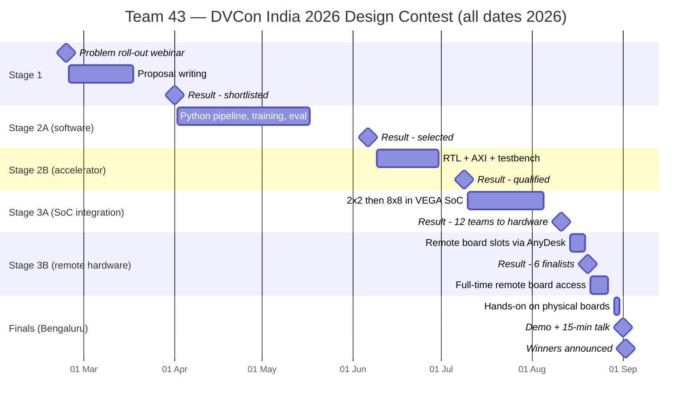

# 02 — The journey, stage by stage

The contest ran for about eight months, from February to early September 2026. Each stage had to be passed to reach the next. This page tells the whole story in order, with dates. Each stage also has its own detailed page.

---

## Stage 0 — Registering and forming the team (February 2026)

- Teams of two or three university students registered through EasyChair. Team 43 took the name **Silicon Syndicate**.
- **23 Feb 2026** — the organisers held a problem-statement roll-out webinar.
- **26 Feb 2026** — the Stage 1 report template was released.

## Stage 1 — The proposal (late February to March 2026)

**What was asked:** understand the COCO dataset and task-aware detection, get familiar with the VEGA processor and Genesys 2 board, and submit a proposal using the given template (deadline 10 March, later extended several times).

**What we did:** studied the reference paper, profiled YOLOv8n and MobileCLIP with the PyTorch profiler, found that convolutions dominate the work, and proposed an FPGA **systolic-array** matrix-multiply accelerator to speed them up. Our first pipeline idea was *YOLOv8n finds objects → MobileCLIP compares each crop with the task text*.

**Result — 1 April 2026:** proposal **shortlisted**, team moved to Stage 2.

➡ Details: [03 — Stage 1 proposal](03_stage1_proposal.md)

## Stage 2A — A working software pipeline (April to 17 May 2026)

**What was asked:** functionally correct code for task-based object detection, a two-page report (approach + results), and a video demonstration. A briefing and Q&A was held on 8 April; the deadline was extended to **17 May**.

**What we did:**

- Converted COCO-Tasks into simple JSON-lines files (one row per image + task).
- Tried **MobileCLIP** (image–text matching on object crops). Dropped it: YOLO already gives class names, so comparing *text with text* is cheaper and easier to train.
- Fine-tuned **all-MiniLM-L6-v2** as a *task–object suitability scorer* on Google Colab (Tesla T4 GPU, 20 epochs). Best validation top-1: **0.9603** at epoch 18.
- Paired it with **YOLOv8x** (we also tried fine-tuning YOLOv8n on COCO-Tasks: mAP50 0.496).
- Measured the pipeline on a balanced 1,000-row sample of the COCO-Tasks test set: **85.4 % positive top-1**, 72.3 % overall.
- The EasyChair upload limit was 100 MB, which our code + weights exceeded, so we uploaded the report and video and shared the full package by Google Drive link.

**Result — 6 June 2026:** **selected** for Stage 2B.

➡ Details: [04 — Stage 2A software pipeline](04_stage2a_software_pipeline.md)

## Stage 2B — The accelerator on its own (9 to 30 June 2026)

**What was asked:** an accelerator and interface for the software solution, with a working design, AXI interface, testbench, Vivado/Questa makefile, README and report. A mandatory workshop on the RISC-V processor and the Genesys 2 board was held by C-DAC on 9 June — right in the middle of our semester-end examinations.

**What we did:** built a standalone **AXI-stream systolic array** with three read DMAs (weights, activations, bias), one write DMA (results), an AXI-Lite register file and a crossbar, starting from an open-source design (see [05](05_stage2b_accelerator.md)). We verified it with a self-checking testbench (`Y_dut == Y_ref`) and wrote a speed-up model, a block-diagram specification and a waveform guide.

**Result — 9 July 2026:** **qualified** for Stage 3A.

➡ Details: [05 — Stage 2B accelerator](05_stage2b_accelerator.md)

## Stage 3A — Inside the VEGA SoC, in simulation (10 July to 5 August 2026)

**What was asked:** integrate the accelerator into C-DAC's VEGA SoC, prove it works in a **full-system simulation** (CPU + bus + accelerator + memory), and **synthesise** it, using only the organisers' environment and tools. The organisers would download each submission and run its scripts themselves. Materials came on 10 July; a briefing was held on 14 July.

**What we did:**

1. A first **2×2** version (late July): wrote `Accelerator_Top.v` to match the empty slot in `Top.vhd`, so no organiser file needed editing. Found that the simulation netlist ties DDR off, so all test buffers had to live in internal SRAM.
2. The final **8×8** version (2–5 August):
   - a bare-metal C program on the simulated VEGA that configures the accelerator, waits, then **re-computes all 64 results in software and compares them**, printing `B`, `C`, `S`, `P` on the UART (`BCSP` = pass);
   - an independent Python **golden model**;
   - a strict **VCD analyser** that rebuilds every AXI transaction from the waveform and checks 22 protocol rules and all 64 results;
   - one-click Linux and Windows run scripts with hash checks.
3. Result: simulation **ACCEPTED**, synthesis **6.09 % of LUTs, 0 DSP, 0 BRAM**.

Submissions were shared via Google Drive. The deadline was extended on 6 August.

**Result — 11 August 2026:** **12 teams** selected for the new *Hardware Implementation* stage. Team 43 was one of them.

➡ Details: [06 — Stage 3A SoC integration](06_stage3a_soc_integration.md)

## Stage 3B — Real hardware, reached remotely (13 to 19 August 2026)

**What was asked:** implement the design on the real FPGA board. The boards were in a C-DAC lab, so teams worked **remotely**.

**How remote access worked:**

- **13 Aug** — debrief meeting. Every team member installed **AnyDesk** (remote-desktop software) and sent their AnyDesk ID to the organisers.
- The organisers sent each team login details for a lab PC (CentOS 7 Linux, with Vivado, Docker and a Genesys 2 board connected by JTAG, UART and Ethernet).
- **14–17 Aug** — each team got **two day slots (9:30–17:30) and two night slots (18:30–08:30 next day)**. At the end of a slot you had to log out at once, otherwise the next team could see your files.
- **18 Aug** — a little extra time to capture results and the demo video.
- **19 Aug, 11:00 IST** — submission deadline: project location, implementation report, "path forward for a conference demo", and a short video.

**What we did:** built the bitstream on the lab PC (Vivado 2020.2), booted VEGA Linux on the board, and brought up the full pipeline in four milestones, each run on the board before the next was started:

| Milestone | What ran on the board | Result |
|---|---|---|
| A | One real MiniLM layer on the accelerator | 3,072 / 3,072 outputs exact |
| B | Full MiniLM task scoring over 80 classes | "serve wine" → wine glass 0.970027 |
| C | YOLOv8n detection end to end | detections match the PC reference |
| D | The complete pipeline: image + task in → marked image out | **PASS**, wine glass selected, 538.8 s |

**Result — 20 August 2026:** **6 finalists** chosen. Team 43 was one of them.

➡ Details: [07 — Stage 3B remote hardware](07_stage3b_remote_hardware.md)

## Final development phase — still remote (21 to 27 August 2026)

- Finalists got **full-time** access to an assigned board until 27 August. To share boards fairly, our team was moved to a different machine ("CDAC-1") with new credentials on 21 August.
- In this week we made the biggest speed-ups and accuracy gains:
  - **K-depth collapse** — let one accelerator call add up a whole dot-product instead of 8 numbers: **713 s → 218 s** at 320 px, bit-identical.
  - Found and fixed two "correct by accident" bugs (the `Y_DONE` flag and the FMA rounding difference between x86 and RISC-V).
  - Added **YOLOv8s** (same graph, wider layers) for much better accuracy.
  - Measured accuracy with the paper's own metric on COCO-Tasks.
  - Ran all **14 tasks on the board** (26 August) as evidence.
- At the same time we arranged **visas and flights** from Sri Lanka to India at short notice, and filled in the organisers' copyright form and presentation template.

## Finals — Bengaluru (29 August to 3 September 2026)

- **29 Aug** — flew from Colombo to Bengaluru in the morning, checked in at The Hosteller (Marathahalli) at 2 PM, reached the Radisson Blu venue at 3 PM.
- **29 Aug 15:30 → 31 Aug** — **hands-on work on physical boards** at the venue, with mentors available the whole time. For the first time the board was on the table in front of us instead of behind a remote-desktop window. We completed the hardware implementation and final board-level validation, and rehearsed the cold-start demo sequence from our finals plan.
- **30 Aug** — final presentation submitted.
- **1 Sep** — boards set up in the Marquis room at 7:30. Our team presented in the **11:30–13:00** session (15-minute talk, 5-minute Q&A, 10-minute live demo), then explained the work to visitors at the demo booth and attended C-DAC's workshop.
- **2 Sep (evening)** — at the conference awards, Team 43 — Silicon Syndicate was announced as the **Winner of the DVCon India 2026 Design Contest** (award cheque dated 3 September 2026).

➡ Details and photos: [08 — Finals in Bengaluru](08_finals_bengaluru.md)

---

## The funnel

| Point in the contest | Teams |
|---|---|
| Registered | 650+ teams (India and Sri Lanka) |
| Selected for the hardware stage (after Stage 3A) | 12 |
| Finalists (after Stage 3B) | 6 |
| Winner | **Team 43 — Silicon Syndicate** |
