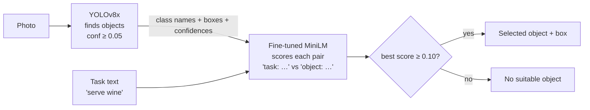

# 04 — Stage 2A: the software pipeline (April – 17 May 2026)

**Goal of the stage:** functionally correct code that selects the right object for a task, a two-page report (one page approach, one page results) and a video demonstration.

**Outcome:** selected for Stage 2B on **6 June 2026**.

Code from this stage: [`stage2_software_pipeline/`](../stage2_software_pipeline/README.md). Our report text: [`reports/stage2a_report_text.md`](reports/stage2a_report_text.md).

---

## 1. The idea in one picture

1. **YOLOv8x** (stock COCO weights from Ultralytics) detects objects. The confidence floor is kept low (0.05) so that a useful object is not thrown away before the ranking step — *if the detector misses the right object, nothing later can recover it.*
2. A **fine-tuned MiniLM** scores how suitable each detected *class name* is for the task text.
3. The object with the highest score is selected, if the score is at least 0.10. Otherwise the answer is "no suitable object".

## 2. Why we changed from the Stage 1 plan

| Stage 1 plan | Stage 2A choice | Reason |
|---|---|---|
| YOLOv8n | **YOLOv8x** | In software we could afford the biggest detector; recall (not missing objects) matters most |
| MobileCLIP (image crop ↔ text) | **MiniLM (text ↔ text)** | YOLO already gives the class name. Comparing two short texts is far cheaper than running an image model on every crop, and much easier to fine-tune |

The MobileCLIP experiment (April 13–17) is kept in [`stage2_software_pipeline/experiments/mobileclip_abandoned/`](../stage2_software_pipeline/experiments/mobileclip_abandoned/README.md) with notes on what went wrong — including a one-letter bug that silently turned every crop into a black image.

## 3. The ranker — a fine-tuned MiniLM

**Base model:** [`sentence-transformers/all-MiniLM-L6-v2`](https://huggingface.co/sentence-transformers/all-MiniLM-L6-v2) — a small sentence-embedding model (6 layers, hidden size 384, 12 attention heads, ~22 M parameters).

**How it scores a pair:**

1. Encode `"task: <prompt>"` → vector **t** (384 numbers, mean-pooled and L2-normalised).
2. Encode `"object: <class name>"` → vector **o**.
3. Join four views of the pair into one 1,536-number vector: `[t, o, |t − o|, t ⊙ o]` (⊙ = element-wise product).
4. A small trained head: `Linear(1536→384) → ReLU → Dropout(0.1) → Linear(384→1) → sigmoid` gives a score from 0 to 1.

**Training data:** COCO-Tasks converted to JSON-lines by [`dataset_tools/make_coco_tasks_jsonl.py`](../stage2_software_pipeline/dataset_tools/make_coco_tasks_jsonl.py) — one row per (image, task), listing every annotated object with its COCO class and a *preferred* flag. 50,305 training rows and 12,588 test rows.

**Training method** ([`training/train_minilm_ranker.py`](../stage2_software_pipeline/training/train_minilm_ranker.py)):

- Each row becomes a *group*: all distinct object classes in that image for that task. A class is positive if any of its instances is preferred.
- Loss = binary cross-entropy (positives weighted ×6.58, because negatives are ~6.6× more common) **+** a margin ranking loss that pushes every positive class above every negative class in the same group by a margin of 0.25.
- AdamW, learning rate 2e-5, weight decay 0.01, batch 16 groups × gradient accumulation 4, 20 epochs, mixed precision, max 32 tokens.
- Hardware: **Google Colab, Tesla T4 GPU** ([`colab_train_minilm.ipynb`](../stage2_software_pipeline/training/colab_train_minilm.ipynb)).

| Epoch | Train top-1 | Validation top-1 | Validation loss |
|---|---|---|---|
| 1 | 0.8434 | 0.9274 | 0.4164 |
| 4 | 0.9394 | 0.9530 | 0.2864 |
| 8 | 0.9462 | 0.9564 | 0.2745 |
| **18 (best, kept)** | **0.9503** | **0.9603** | **0.2683** |
| 20 | 0.9497 | 0.9600 | 0.2710 |

A 50-epoch run reached only 0.9608, so 20 epochs was enough.

> **Honest note.** The training script used the COCO-Tasks *test* split as its validation set to choose the best epoch. Later, in the hardware stages, we measured accuracy with the paper's own protocol and metric (see [evaluation/](../evaluation/README.md)), which is the number we quote for the final system.

## 4. A detector experiment we dropped

We also fine-tuned **YOLOv8n** on the COCO-Tasks images (80 COCO classes, 640 px, batch 16, 20 epochs, ~4.1 h on Colab): precision 0.602, recall 0.462, **mAP50 0.496**, mAP50-95 0.343 ([`training/yolo_finetune_run/`](../stage2_software_pipeline/training/yolo_finetune_run/)). For the Stage 2A submission the stock **YOLOv8x** gave better recall, so we switched to it around 16 May.

## 5. Results we submitted

Balanced sample of **1,000 (image, task) rows** from the COCO-Tasks test set, ~71 rows per task, random seed 7 ([`pipeline/batch_test_1000_pipeline.py`](../stage2_software_pipeline/pipeline/batch_test_1000_pipeline.py), results in [`results/`](../stage2_software_pipeline/results/)).

| Metric | Value |
|---|---|
| Overall accuracy | **72.30 %** |
| Rows with a preferred object: top-1 correct | **85.43 %** (428 / 501) |
| … when YOLO detected an expected class | **87.53 %** |
| Expected class in top-5 (when detected) | **97.96 %** |
| Rows with no preferred object: correctly rejected | 59.12 % (295 / 499) |

Example (COCO val 000000000241, "serve wine"): **cup** selected with MiniLM 0.934 and YOLO 0.915, while people in the photo had YOLO confidence up to 0.956 but MiniLM only 0.0001 — the ranker, not the detector, makes the choice.

> **What "correct" means here.** In this stage we checked the **class** of the selected object, not the overlap of its box with the ground truth. That is simpler than the paper's mAP@0.5. From Stage 3B on we used the paper's exact box-level metric.

Per-task results (overall / positive top-1 / negative rejection):

| Task | Overall | Pos. top-1 | Neg. rejection |
|---|---|---|---|
| step on something… | 0.704 | 0.949 | 0.406 |
| sit comfortably | 0.775 | 0.944 | 0.235 |
| place flowers | 0.761 | 0.833 | 0.686 |
| get potatoes out of fire | 0.833 | 0.959 | 0.565 |
| water plant | 0.676 | 0.757 | 0.588 |
| get lemon out of tea | 0.431 | 0.788 | 0.128 |
| dig hole | 0.778 | 0.941 | 0.381 |
| open bottle of beer | 0.625 | 0.733 | 0.596 |
| open parcel | 0.833 | 0.750 | 0.857 |
| serve wine | 0.746 | 0.810 | 0.720 |
| pour sugar | 0.592 | 0.761 | 0.280 |
| smear butter | 0.761 | 0.630 | 0.841 |
| extinguish fire | 0.694 | 0.722 | 0.685 |
| pound carpet | 0.915 | 0.949 | 0.750 |

## 6. Why this design carried all the way to the board

The text-only ranker turned out to be the key decision of the whole project:

- The ranker never looks at pixels — only at the task text and the class name. So the **80 class-name embeddings never change** and can be computed once, offline, and shipped with the model. On the board only the *task* sentence has to be encoded.
- It is small (6 layers, sequence length 8 on the board), so it fits a 50 MHz CPU + 8×8 accelerator.
- On ground-truth boxes, the INT8 version on the board picks the right object **94.7 %** of the time. The remaining errors come almost entirely from the detector missing small objects at low resolution — see [TECHNICAL_REPORT §13](TECHNICAL_REPORT.md#13-accuracy).

## 7. Practical notes

- **EasyChair limit.** The submission portal accepted one file of at most 100 MB. Our code + weights were larger, so we uploaded the report and video and shared everything else through a Google Drive link by email. Check upload limits early.
- **Large files.** The trained MiniLM checkpoint is 278.6 MB (it includes optimizer state) and YOLOv8x is 137 MB. They are **not** in this repository; the checkpoint can be re-trained with the notebook, and the INT8 packages derived from it *are* included in [`models/`](../models/README.md).
