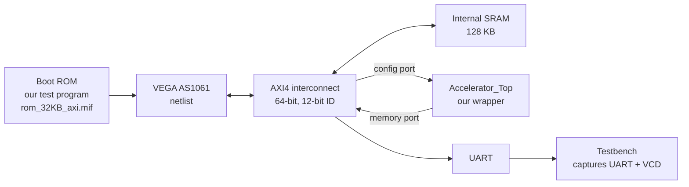

# 06 — Stage 3A: putting the accelerator inside the VEGA SoC (10 July – 5 August 2026)

**Goal of the stage (from the organisers):** *"Integrate your accelerator design with the C-DAC VEGA SoC and provide fully integrated simulation results"*, then synthesise it in Vivado for the Genesys 2. The organisers would download each submission and run its scripts themselves; anything missing or not reproducible could be rejected.

**Outcome:** on **11 August 2026**, 12 teams were selected for a new *Hardware Implementation* stage. Team 43 was one of them.

Everything from this stage is in [`hardware/stage3a_simulation/`](../hardware/stage3a_simulation/README.md) and [`hardware/accelerator_ip/`](../hardware/accelerator_ip/).

---

## 1. What "full-system simulation" means here

In Stage 2B a *testbench pretended to be the CPU*. In Stage 3A the **real VEGA CPU** (as a simulation netlist from C-DAC) runs a real program from the boot ROM, talks to our accelerator over the real AXI interconnect, and the accelerator reads and writes real SoC memory. If the simulation passes, the design has already met the CPU, the bus and the memory system — before any hardware exists.



## 2. Fitting into the SoC without editing it

The organisers' `Top.vhd` already declared an empty component named `Accelerator_Top`. We wrote [`Accelerator_Top.v`](../hardware/accelerator_ip/Accelerator_Top.v) with **exactly the same port list**, so no organiser file had to be changed — the cleanest possible answer to the rule *"use only the provided files"*.

Inside the wrapper:

```
 SoC config port (AXI4, 64-bit data/addr, 12-bit ID)        SoC memory port
        │ s_axi_*                                                ▲ m_axi_*
        ▼                                                        │
  axi_axil_adapter ──AXI-Lite 32-bit──► top_axi_int ─────────────┘  (native 64-bit master)
```

Changes made to the accelerator for the SoC ([`INTEGRATION_NOTES.md`](../hardware/accelerator_ip/INTEGRATION_NOTES.md)):

| What | Before | After | Why |
|---|---|---|---|
| `AXI_WIDTH`, `ADDR_WIDTH` | 32 | **64** | match the SoC bus |
| `AXI_ID_WIDTH` | 6 | **12** | match the interconnect |
| `AXIL_BASE_ADDR` | `0xB000_0000` | **`0x2004_0000`** | the SoC's accelerator address |
| `R`, `C` | 2 | **8** | final array size |
| `s2mm_tag` | undriven (X in simulation) | tied to 0 | an undriven output is a hidden risk |
| AXI ID assignments | `DMA_ID_WIDTH'(0)` cast | `{DMA_ID_WIDTH{1'b0}}` | accepted by every Vivado version |

**A surprise:** the SoC simulation netlist ties all DDR3 pins to zero, and the testbench's DDR models are unbound. So in simulation **all test buffers had to live in the 128 KB internal SRAM** (`0x20000`–`0x37000`), not in DDR.

## 3. The first attempt: 2×2 (late July)

We first integrated a **2×2** array to get the plumbing right: firmware, ROM image, simulation scripts that work on Windows, and a hand-checking waveform guide. It passed (Y = [29, 73, 42, 90]) and synthesised at 2.56 % of LUTs. We kept its documents in [`docs/archive/stage3a_2x2/`](archive/stage3a_2x2/).

While doing this we also found several problems in the organiser kit and worked around them **without editing their files** (by adding our own scripts next to theirs): hard-coded paths in `run.sh` and the TCL scripts, a missing `$` in `MDIR_PATH`, a `run` command commented out in `DVCon_SIM.tcl`, and a QuestaSim script that did not search sub-folders.

## 4. The final version: 8×8 with verification you can trust (2 – 5 August)

We wanted a result that a stranger could re-run and *believe*. So the pass/fail decision is made by **three independent checks**, not by a person looking at a waveform.

### 4.1 Self-checking firmware — [`stage3a_main.c`](../hardware/stage3a_simulation/firmware/stage3a_main.c)

A bare-metal C program in the boot ROM that:

1. writes X, K and B into SRAM (signed values written as true two's-complement bytes),
2. programs the accelerator registers and writes START,
3. polls DONE **with a time limit** (so a hang still produces an answer),
4. **re-computes all 64 results in software and compares them**,
5. prints one letter per phase on the UART: **`B`** booted, **`C`** configured, **`S`** started, **`P`** pass (or **`F`** fail).

Success is exactly the string **`BCSP`**. `_Static_assert` checks prove at compile time that the buffers do not overlap each other or the stack.

### 4.2 An independent golden model — [`golden_8x8.py`](../hardware/stage3a_simulation/firmware/golden_8x8.py)

Written separately from the firmware and the RTL, so that a shared misunderstanding cannot pass unnoticed. The test matrices come from simple formulas, so anyone can recompute the answer:

```
X[r][k] = ((3r + 2k) % 11) − 5      K[k][c] = ((5k + 3c) % 9) − 4      B[r][c] = 2r − c
```

Both operands span negative and positive values, which exercises two's-complement handling everywhere. Two entries were also checked by hand (`Y[0][0] = 27`, `Y[7][7] = −28`).

### 4.3 A strict waveform analyser — [`analyze_vcd_8x8.py`](../hardware/stage3a_simulation/firmware/analyze_vcd_8x8.py)

A Python program that reads the simulation's VCD file and **rebuilds every AXI transaction from first principles**: a transfer happens only on a rising clock edge where `VALID` and `READY` are both 1; write addresses are paired with write data; reads are paired by ID. It also decodes the UART line bit by bit. It checks, among others:

- the UART text is exactly `BCSP`,
- every K, X and bias beat read from memory matches the expected packing,
- the raw array output, the bias-added stream and the write-DMA stream all agree with each other and with the golden model (64/64),
- **22 AXI protocol properties** — OKAY responses, `WSTRB`, `WLAST`, `RLAST`, burst type and size, ID pairing, no unexpected addresses, no DDR access.

It exits with a non-zero code on any single failure, so a "PASS" banner cannot come from a half-working design. Its report for our run: [`stage3a_8x8_vcd_analysis.md`](../hardware/stage3a_simulation/results/stage3a_8x8_vcd_analysis.md).

How much would a mistake change the output? We measured it: a transposed activation matrix changes 64/64 outputs, a dropped bias 60/64, an unsigned misread 56/64. So the test is sensitive to the bugs that matter.

### 4.4 One-click, cross-platform run scripts

- [`run/run_stage3a.sh`](../hardware/stage3a_simulation/run/run_stage3a.sh) (Linux) and [`run_stage3a.ps1`/`.cmd`](../hardware/stage3a_simulation/run/) (Windows): modes `--simulation`, `--synthesis`, `--all`, `--check`.
- [`tcl/DVCon_SIM_stage3a.tcl`](../hardware/stage3a_simulation/tcl/DVCon_SIM_stage3a.tcl): builds the wave layout *before* running (so every signal is logged from time 0), **checks the SHA-256 of the boot-ROM image**, runs 1,500 µs, then calls the analyser.
- [`tcl/DVCon_SYN_stage3a.tcl`](../hardware/stage3a_simulation/tcl/DVCon_SYN_stage3a.tcl): synthesis that fails if there are black boxes, if `u_Accelerator_Top` is missing, or if fewer than **64 distinct PE instances** survive (an optimised-away array would otherwise look "small and fast"). It switches to a lighter flow on PCs with less than 12 GB of RAM.

## 5. Results

**Simulation — ACCEPTED** (5 Aug 2026, Vivado 2025.2 XSim, 24–30 min wall-clock):

| Event | Simulated time |
|---|---|
| UART `B` | 29.87 µs |
| Configuration writes | 466.45 – 471.07 µs |
| START | 473.55 µs |
| First result written | 476.59 µs |
| DONE | 479.23 µs |
| UART `P` | 1,109.87 µs |

The array itself needed about **6 µs** from START to DONE; the rest is the CPU booting and printing.

**Synthesis — PASS** (Vivado 2025.2):

| Scope | LUT | FF | BRAM | DSP |
|---|---|---|---|---|
| **Accelerator** | **12,404 (6.09 %)** | 12,711 (3.12 %) | 0 | 0 |
| Whole SoC | 95,749 (46.98 %) | 50,086 (12.29 %) | 81 (18.20 %) | 50 (5.95 %) |

The 8×8 PE array is 7,168 of the accelerator's LUTs. The 50 DSPs belong to the VEGA core; our INT8 multipliers are built from LUTs. (After full place-and-route on the board in Stage 3B the accelerator measured 11,945 LUTs, 5.86 %.)

**Cross-version check:** the design was run under Vivado **2018.1, 2025.2 and 2026.1**, on Linux and Windows. Utilisation agreed within 0.2 % across a seven-year tool gap.

## 6. The trap that almost cost us the stage

`rom_32KB_axi.mif` (the boot-ROM contents) is **not a plain file** — it is an *output product* of the ROM IP, regenerated from a `.coe` file whenever the IP is rebuilt. Newer Vivado versions left the 2018.1-made IP locked and our file survived. The organisers' own Vivado 2018.1 would **regenerate it and silently replace our test program with their default bootloader**. The design would have looked broken on the judges' machine while being entirely correct.

It was caught by the **hash check** in our run script, not by a failing simulation. The fix: ship our program in **both** the `.mif` and the `.coe`, so either path boots the right image. Lesson: *hash every input you depend on.*

## 7. What we submitted

Following the organisers' guideline ("copy your entire environment with all files required for running the simulation to Google Drive"), we shared the whole organiser environment with our accelerator, firmware, scripts, waveform, reports and documents. This repository contains **only our files** from that package; the organiser files (VEGA netlist, `Top.vhd`, testbench, constraints, ROM IP, toolchain, Docker image) are not public.

## 8. Tips for future teams

- **Do not edit the organiser files** if you can avoid it — add wrappers and your own scripts beside them.
- **Make the machine decide pass/fail.** A self-checking program + an independent golden model + an automatic waveform checker is far more convincing than screenshots.
- **Put a time limit on every wait** in test firmware, so a hang still prints something.
- **Hash your inputs** (ROM images, MIF files) and check the hash in the run script.
- **Try more than one tool version** if the judges may use a different one.
- **Assume the judge has a different PC.** Relative paths, auto-detected folders and RAM-aware synthesis settings saved us.
