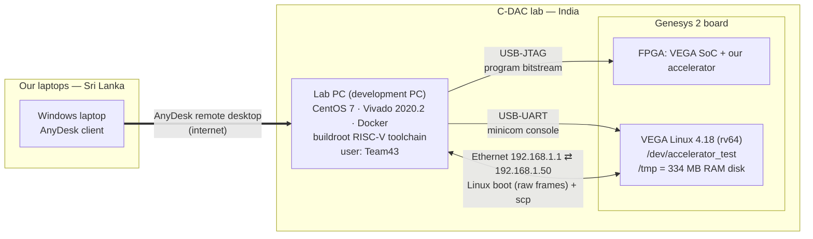

# 07 — Stage 3B: real hardware, reached remotely (13 – 27 August 2026)

**Goal of the stage:** *"implement your design remotely on the FPGA platform"* — make the whole task-aware pipeline run on the real Genesys 2 board, with the real VEGA CPU and our accelerator.

**Outcome:** on **20 August 2026** Team 43 was chosen as one of **6 finalists**. Finalists then kept remote board access until 27 August.

This page explains **how we worked on a board in another country through a remote desktop**, what we built, and what we learned. All commands below are real; **passwords and remote-access IDs are deliberately left out**.

---

## 1. The set-up: three machines

The boards were in a C-DAC lab in India; we were in Sri Lanka. Three machines were involved:



| Machine | Path / address | What it was used for |
|---|---|---|
| Our laptop | — | Only a window into the lab PC (AnyDesk). Also used offline for the PC-side simulation (`--sim`) and accuracy evaluation |
| **Lab PC** (CentOS 7, hostname `hdg_vivado-lab2`, later a second machine "CDAC-1") | `/home/Team43/Desktop/DVCon_2026` | Building the bitstream (Vivado), cross-compiling the C program (Docker + buildroot), serial console, sending files |
| **Genesys 2 board** running VEGA Linux | `/tmp/team43` on the board, IP `192.168.1.50` | Where the demonstration actually runs |

## 2. How the remote access was organised

- **11 Aug** — the organisers announced the hardware stage: *"remote board access will be provided from 14 August to 17 August across four assigned sessions."*
- **13 Aug** — debrief and Q&A (Zoom). Every team member created an **AnyDesk** account and submitted their AnyDesk ID in a shared sheet. The same lab-PC login was shared by all members of a team.
- The organisers then e-mailed each team its lab-PC credentials (we never put them in code, reports or videos).
- **Slots:** each team had **two day slots (09:30–17:30)** and **two night slots (18:30–08:30 next day)** between 14 and 17 August.
- **Slot discipline:** *"Once your slot is completed, remember to log out immediately. Failure to do so may allow the next team to access your files and workspace."*
- **18 Aug** — a little extra time to capture final results and record the demo video.
- **19 Aug, 11:00 IST** — submission: project-folder location, implementation report (work done, completion %, adherence to the brief, implementation details and utilisation), *path forward if a demo is needed at the conference*, and a short demo video. EasyChair would not let us update our entry, so we e-mailed a PDF with a Google Drive link.
- **20 Aug** — finalists announced. Finalists got **full-time** access to an assigned board until **27 Aug**; on 21 Aug we were moved to another machine ("CDAC-1") with new credentials, so that every finalist had a board.

### Planning for slots

With only four slots, we did as much as possible **off the board**:

- The C program has a `--sim` mode that emulates the accelerator exactly. We debugged almost everything on our own laptops first, and used board time only for things that needed the board.
- We wrote **small probe programs** that answer one hardware question in seconds (see [`firmware/probes/`](../firmware/probes/README.md)), instead of running the full 9-minute pipeline to test one idea.
- Every board run was **logged to a file** (`| tee`), so evidence survived the end of the slot.

## 3. The daily workflow on the board

This is the sequence we ran (from our [Stage 3B quick-start guide](reports/stage3b_quick_start.md)).

**Step 1 — Program the FPGA** (on the lab PC):

```bash
cd /home/Team43/Desktop/DVCon_2026/RUN
./run.sh          # organiser menu → option 3 "FPGA Programming"
```

This loads `DVCon_2026.bit` (VEGA SoC + our accelerator) through JTAG. Menu option 2 rebuilds the bitstream from RTL (full implementation takes hours).

**Step 2 — Open the serial console and boot Linux** (two lab-PC terminals):

```bash
sudo minicom dvcon                         # terminal 1: board console, wait for "Waiting for data..."
cd /home/Team43/Desktop/DVCon_2026/FILE_TRANSFER && ./send.sh   # terminal 2: send Linux image + device tree
```

`send.sh` (organiser script) pushes the Linux image (`bbl.bin`) and device tree over **raw Ethernet frames** to the board's MAC address. Linux boots on the VEGA core; log in at the `C-DAC Linux` prompt.

**Step 3 — Bring up the network** (on the board, after every boot):

```sh
ifconfig eth0 192.168.1.50 netmask 255.255.255.0 up
ping -c 3 192.168.1.1
```

**Step 4 — Cross-compile the program** (on the lab PC, only after a code change):

```bash
docker run --rm -t -v "$PWD":/workspace -w /workspace --user $(id -u):$(id -g) \
  buildroot-2004_new bash -c \
  'buildroot_dvcon/buildroot/output/host/bin/riscv64-buildroot-linux-gnu-gcc \
     -std=gnu99 -O2 -ffp-contract=off -static -Wall -Wextra \
     -o team43_pipeline team43_pipeline.c -lm -lrt'
```

**Step 5 — Copy files to the board.** The **board pulls** from the PC with `scp` (about 30 MB, ~6 minutes at the measured **94 KB/s**). BusyBox `tar` on the board has no `-z`, so unpack with `gzip -dc file.tar.gz | tar -xvf -`. Then **verify the payload** before running anything:

```sh
mkdir -p /tmp/team43 && cd /tmp/team43
scp Team43@192.168.1.1:/home/Team43/Desktop/DVCon_2026/team43_deploy.tar .
tar -xf team43_deploy.tar
./verify.sh            # must print: PAYLOAD OK -- N files match
```

**Step 6 — Run a query** (on the board):

```sh
./team43_pipeline_n --image live_image.jpg --task "serve wine" --imgsz 256 --rect \
   --yolo team43_yolo_int8.bin --minilm team43_minilm_int8.bin --vocab vocab.txt \
   --packed team43_minilm_packed.bin --out result.ppm | tee run.log
```

**Step 7 — Get the result back** — `scp` the `result.ppm` to the PC and convert it to PNG (`evaluation/scripts/ppm_to_png.py`).

> **`/tmp` on the board is a RAM disk.** A power cycle wipes everything you copied. Keep the board powered between sessions, and keep a one-command "cold start" script (ours: [`firmware/scripts/rcold_s256`](../firmware/scripts/rcold_s256)).

## 4. Building the bitstream on the lab PC

- Tool: **Vivado 2020.2** on the lab PC, device `xc7k325tffg900-2`, full implementation with the organiser's `DVCon_IMP.tcl` (via `run.sh` → 2 → 2).
- Our accelerator RTL went in unchanged from Stage 3A — **no RTL change was needed for hardware bring-up**, because the design had already been verified against the same SoC in simulation.
- Result (post-route, 15 Aug): accelerator **11,945 LUTs (5.86 %)**, 12,706 FFs, 0 BRAM, 0 DSP; whole SoC 107,937 LUTs (52.96 %).
- Timing: the 50 MHz system clock met with **WNS +0.556 ns**. One hold path (−0.659 ns) failed on the Ethernet receive input inside an organiser block; it did not involve our logic and the link worked. Reports: [`hardware/reports/`](../hardware/reports/).

## 5. Bring-up in four milestones (16 – 17 August)

We never tried to run the whole pipeline first. Each milestone had to pass **on the board** before the next was attempted, and each has a captured board log in [`results/board_logs/milestones/`](../results/board_logs/milestones/).

| | Program | What it proved | Board result |
|---|---|---|---|
| 0 | `hello43.c` | A static RISC-V binary built in Docker runs on VEGA Linux | `TEAM43_STANDALONE_OK` |
| probe | `team43_probe.c` | What does one driver call cost? | register write 65 µs, read 62 µs, 256-byte write 268 µs — **cost is per call, not per byte** |
| **A** | `team43_minilm_a.c` | One real MiniLM layer (layer-0 query projection) on the accelerator | **3,072 / 3,072 INT32 outputs exact** |
| **B** | `team43_minilm_b.c` | Full 6-layer MiniLM + head, ranking all 80 classes | "serve wine" → **wine glass 0.970027**, cup 0.933609 |
| **C** | `team43_yolo_c.c` | YOLOv8n detection end to end (103-op graph, 63 convolutions) | detections match the PC reference |
| **D** | `team43_pipeline.c` | Everything: image + task in → marked image out | **PASS** — wine glass selected (0.97006), 517,888 accelerator calls, 538.8 s; output image byte-identical to the PC prediction |

The programs are in [`firmware/milestones/`](../firmware/milestones/).

## 6. The final development week (21 – 27 August)

With full-time access we could finally measure and optimise. Highlights (details in the [technical report §9–§11](TECHNICAL_REPORT.md#9-optimisation-history)):

| Change | Effect | How we knew it was safe |
|---|---|---|
| Upload operands once, inner loop = 5 register writes | **4.37×** faster tile loop | bit-identical output |
| Pack weights by walking the source once | 154.7 s → **7.6 s** | byte-identical on 4 real tensors |
| **K-depth collapse** — one accelerator call adds up a whole dot product | 713 s → **218 s** at 320 px | md5-identical outputs at 128 and 320 px |
| Clear `Y_DONE` before every START | fixed a bug that was "correct by accident" | the `team43_kdepth` probe showed wrong results from K = 512 without it |
| `-ffp-contract=off` on both builds | board and PC agree bit for bit | `fpcheck` fingerprint in every run header |
| YOLOv8s at 256 px instead of YOLOv8n at 192 px | accuracy top-1 0.311 → **0.627**, mAP@0.5 0.201 → **0.425** | same graph, only wider layers; only the generated header and model file change |
| Multi-word register writes | **rejected** — sets only the first word | `team43_regstress` probe |

Two board-health findings from this week:

- **The same binary sometimes ran 4–20× slower** depending on how the FPGA came up after programming, with identical outputs. Strided memory access collapsed while linear copying stayed healthy — a cache/DRAM-latency symptom, not a logic fault. We wrote [`team43_memcheck`](../firmware/probes/team43_memcheck.c), a 5-second test, and made it step one of every session.
- **A truncated file looks valid.** Three of fourteen JPEGs in one transfer arrived cut short; the pipeline happily processed them with garbage at the bottom of the picture. Hence `SHA256SUMS.txt` + [`verify.sh`](../firmware/scripts/verify.sh) in every deployment bundle.

On **26 August** we ran all **14 tasks on the board** with YOLOv8s at 256 px as final evidence — about 274 s per query, all with the same `fpcheck` line. Logs and pictures: [`results/`](../results/README.md).

## 7. Tips for remote hardware work

1. **Treat board time as precious.** Prepare everything on your PC; arrive at a slot with a written list of what to run.
2. **Build a software twin** of your hardware (our `--sim`) so most bugs never need the board.
3. **Write tiny probes** for each hardware question — seconds instead of minutes per experiment.
4. **Log everything with `tee`.** When the slot ends, the evidence must already be saved.
5. **Checksum every transfer** and keep a one-command cold-start script.
6. **Log out at the end of a slot.** Another team gets the same machine next.
7. **Never put credentials in scripts, reports or screen recordings.**
8. **Expect the board to change.** We were moved to a new machine mid-stage; the board's SSH host key changed on every boot (we used `StrictHostKeyChecking=no` for our push script). Scripts with no machine-specific paths survived this easily.
