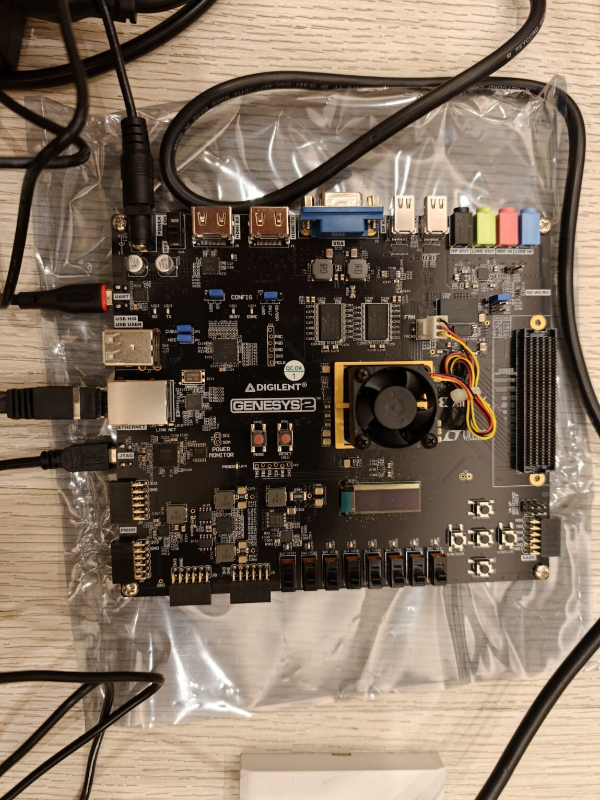
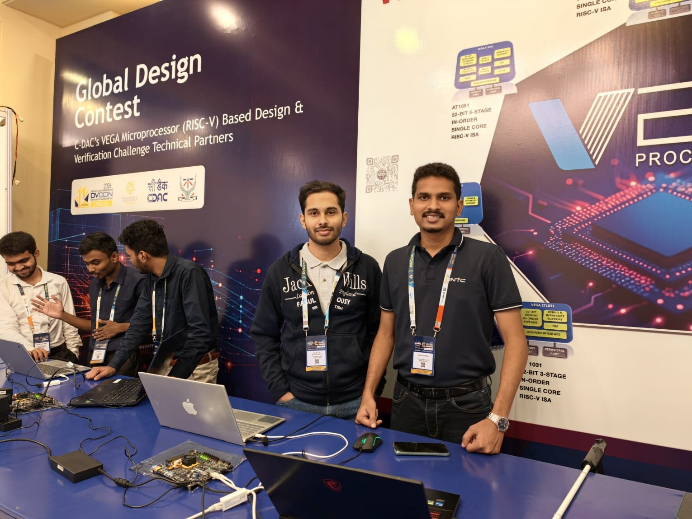
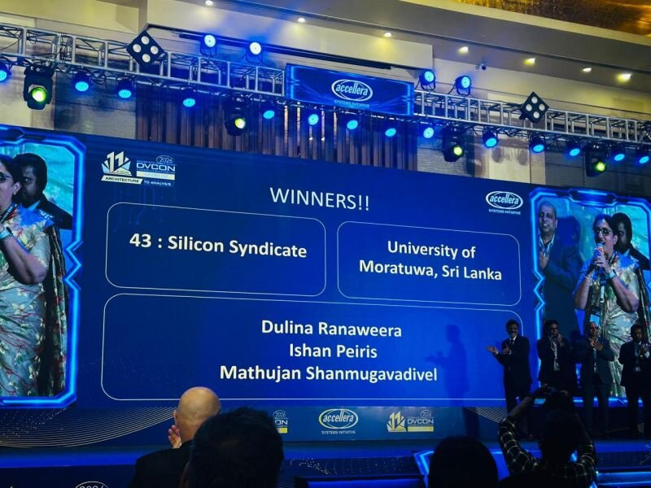
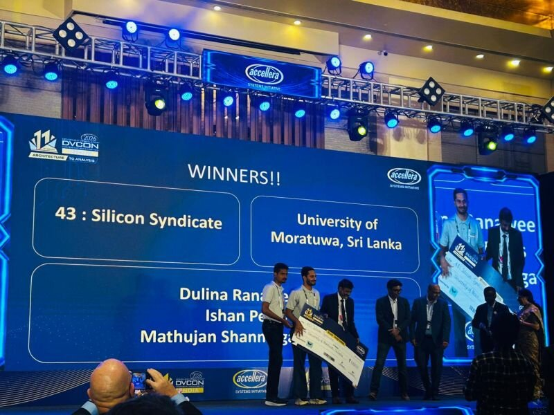
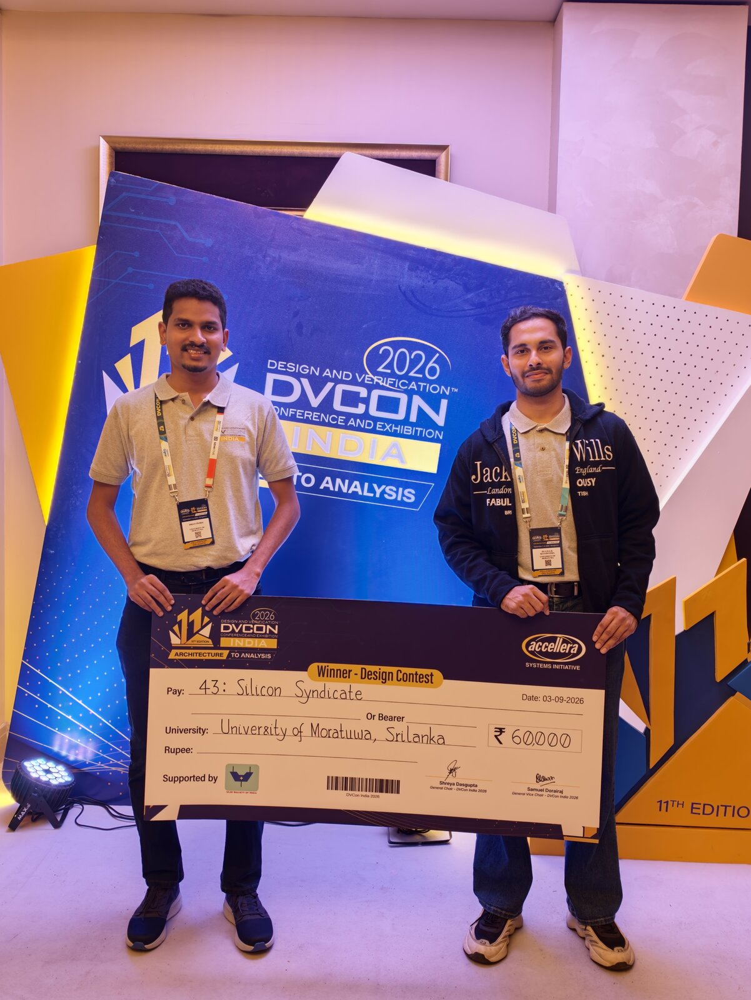
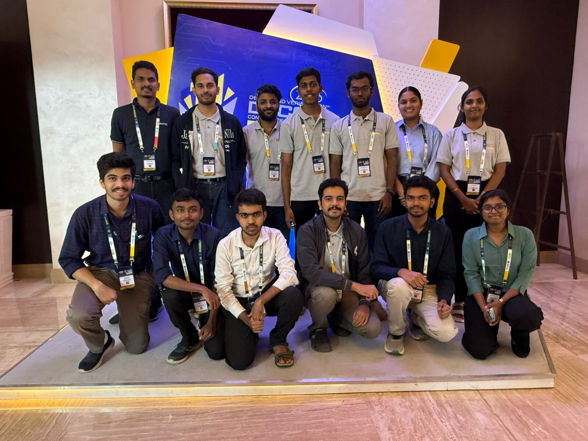
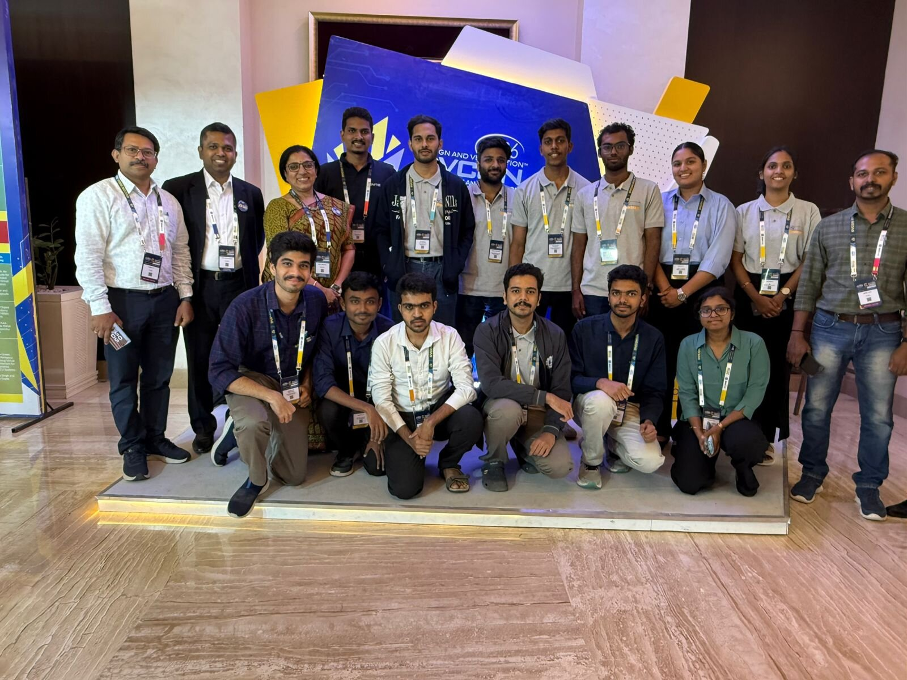

# 08 — The finals in Bengaluru (29 August – 3 September 2026)

After three weeks of working on a board through a remote desktop, the six finalist teams were invited to **Bengaluru, India**, to work **hands-on with physical boards**, demonstrate their systems, and present on stage at **DVCon India 2026**.

---

## 1. Getting there

- The finalists were announced on **20 August**; all teams had to be in Bengaluru by **29 August**.
- As an international team from Sri Lanka we had to arrange **visas and flights at very short notice** (visas came through on 27 August). Two of us travelled.
- The organisers provided a **DVCon India 2026 Fellowship** (conference pass and a travel/food reimbursement) and accommodation at **The Hosteller, Marathahalli**, close to the venue.
- **29 August** — morning flight Colombo → Bengaluru, check-in at 2 PM, at the **Radisson Blu Hotel, Marathahalli** (the conference venue) by 3 PM.

## 2. Hands-on with the boards (29 – 31 August)

From **29 August 15:30 to the evening of 31 August**, the finalists worked on **physical Genesys 2 boards** at the venue, with **mentors available the whole time**.

This was very different from the remote stage:

| Remote stage (14 – 27 Aug) | Finals hands-on (29 – 31 Aug) |
|---|---|
| Board in a lab, seen only through AnyDesk | Board on the table in front of us |
| Fixed time slots; log out at the end of each | Continuous working time, with mentors nearby |

In these days we completed the hardware implementation and the final **board-level validation** of the frozen build (the binaries in [`firmware/prebuilt/`](../firmware/prebuilt/)), and finalised the 15-minute presentation, which was submitted on 30 August. Our plan for this period ([`FINAL_PLAN.html`](reports/FINAL_PLAN.html)) centred on one routine: the **cold start** — bare board → program the FPGA → boot VEGA Linux over Ethernet → bring up the network → pull the deployment bundle → verify checksums → first answer — rehearsed until it was reliable, because on demo day the board may have just been power-cycled ([`firmware/scripts/rcold_s256`](../firmware/scripts/rcold_s256) times every step).

 
<em>The Genesys 2 board during the hands-on session.</em>

## 3. Demo day — 1 September 2026

The organisers' schedule for the day:

| Time | What |
|---|---|
| 07:30 | Boards set up in the **Marquis room** |
| 09:00 – 11:00 | Conference sessions |
| **11:30 – 13:00** | **Presentations of teams 43, 337 and 444** — each a 15-minute talk + 5-minute Q&A, then a 10-minute live demo |
| 14:00 – 14:45 | At the demo booth, explaining the project to conference visitors |
| 14:45 – 15:30 | C-DAC workshop |
| 15:45 – 17:15 | Presentations of the other three finalists |

### Our demo plan

The strongest demonstration is the contrast that opens the reference paper: **the same sentence picks different objects in different photos**, and **different sentences pick different objects in the same photo**.

1. Image with wine glasses + "serve wine" → **wine glass**.
2. Image with only a cup + "serve wine" → **cup**.
3. Same image, a different task → a different object.

Because one query takes minutes on a 50 MHz CPU, our plan was to start a live run first and explain the architecture while it computed, with already-captured board results ready on screen (see [our Stage 3B report §7.6](reports/stage3b_implementation_report.md) and the [finals plan](reports/FINAL_PLAN.html)).

### Our talk — the planned storyline

From the outline in our [finals plan](reports/FINAL_PLAN.html) (written on 24 August):

1. **The problem** — task-driven selection, the reference paper, and why an edge device is the interesting case.
2. **The system** — the SoC, the accelerator, what runs where; the board needs only an ordinary JPEG and a plain-English prompt.
3. **The measurement that mattered** — top-1 accuracy, the oracle ceiling, and *where the errors come from* (the detector loses far more than the ranker).
4. **What we found out about our own ranker** — 94.7 % on clean boxes; competitive with the paper on the paper's own detections.
5. **The bottleneck nobody expected** — ~93 % of a query was driver system calls, and the RTL detail that let one call accumulate a whole dot product.
6. **What we chose not to build** — why the numbers said a bigger array would not help yet.
7. **Live demo.**
8. **Honest limits** — what is still lost, and what we would do with another month.

 
<em>At the "Global Design Contest — C-DAC's VEGA Microprocessor (RISC-V) based Design & Verification Challenge" booth.</em>

## 4. The result

At the conference awards, **Team 43 — Silicon Syndicate, University of Moratuwa, Sri Lanka** was announced as the **Winner of the DVCon India 2026 Design Contest** 🏆.

 
<em>On stage at DVCon India 2026.</em>

 
<em>"Winner — Design Contest", DVCon India 2026 (supported by Accellera and the VLSI Society of India).</em>

## 5. With the other finalists, organisers and mentors

 
<em>Finalist teams at DVCon India 2026.</em>

 
<em>Finalists with the contest organisers and mentors.</em>

## 6. What we would tell the next finalists

- **Rehearse the cold start** until it is boring. On stage, the board may have just been power-cycled.
- **Have the recorded result ready.** A live run that takes minutes needs a story told while it computes.
- **Bring checksums.** The first thing to verify on any new set-up is that your files arrived intact.
- **Know your numbers and your weaknesses.** Judges asked about latency, utilisation and accuracy; saying clearly *where* the time goes and *what* you would do next is stronger than hiding it.
- **Sort out travel early** if you are an international team — visas take time.
- **Enjoy it.** Talking to engineers and other teams at the booth was one of the best parts of the whole journey.
