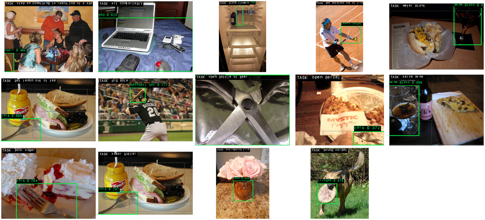

# results/

Evidence captured **on the physical Genesys 2 board**, plus the output images.

```
results/
├── board_logs/
│   ├── milestones/        Stage 3B bring-up: driver probe, Milestones A–D (16–17 Aug 2026)
│   ├── final_14_tasks/    one query per COCO-Tasks task, YOLOv8s INT8, 256 px (26 Aug 2026)
│   └── other/             a YOLOv8n 320 px run and a YOLOv8s 256 px "water plant" run
└── images/
    ├── final_14_tasks/    the marked output image of each of the 14 runs (converted PPM → PNG)
    ├── final_14_tasks_grid.jpg   all 14 in one picture
    └── demo/              Stage 3B demo: board output for "serve wine" and the PC-predicted image
```

## The 14-task run on the board

Same board, same bitstream, same binary (build of 26 Aug 2026), **YOLOv8s INT8 at 256 × 256**, `--rank-by product`, JPEG decoded on the board, `fpcheck 34800000 3efe65ea be54d74a` on every run, **71,433 accelerator calls per query**.

| # | Task | COCO val2014 image | Board selected | Rank (detection × suitability) | Time |
|---|---|---|---|---|---|
| 1 | step on something to reach top of a shelf | 262353 | chair | 0.46514 | 276.1 s |
| 2 | sit comfortably | 395344 | bed | 0.82306 | 274.6 s |
| 3 | place flowers | 132329 | bottle | 0.73550 | 273.2 s |
| 4 | get potatoes out of fire | 000962 | tennis racket | 0.85070 | 273.6 s |
| 5 | water plant | 398604 | wine glass | 0.81284 | 274.4 s |
| 6 | get lemon out of tea | 402528 | fork | 0.89345 | 274.0 s |
| 7 | dig hole | 262565 | baseball bat | 0.77665 | 273.9 s |
| 8 | open bottle of beer | 006177 | scissors | 0.90486 | 274.6 s |
| 9 | open parcel | 272880 | fork | 0.37166 | 272.9 s |
| 10 | serve wine | 146489 | wine glass | 0.86818 | 275.8 s |
| 11 | pour sugar | 393682 | fork | 0.79435 | 274.5 s |
| 12 | smear butter | 402528 | fork | 0.79679 | 273.7 s |
| 13 | extinguish fire | 012860 | vase | 0.84418 | 275.8 s |
| 14 | pound carpet | 526425 | frisbee | 0.91314 | 274.3 s |

- Tasks 6 and 12 use the **same photo**: different tasks choose among the same objects.
- **Task 9 is a known failure** — the board picks a fork; the ground truth says knife. We kept it in the evidence set instead of swapping the photo.
- Typical time split (task 1): detection 68,432 calls / 250.4 s, MiniLM 3,001 calls / 16.6 s, JPEG decode 5.7 s.
- These are single examples that show the system working end to end on the board. Accuracy is measured over the whole test set, not from this table.



## Milestone logs (Stage 3B)

| Log | Content |
|---|---|
| `board_log_driver_probe.txt` | Driver call costs: lseek 25.3 µs, 1-word write 65.3 µs, 1-word read 62.1 µs, 256-byte write 267.5 µs — "cost is per CALL, not per byte" |
| `board_log_milestone_A.txt` | Layer-0 Q projection: **3,072 / 3,072 exact**; hoisted kernel 1.37× faster |
| `board_log_milestone_B.txt` | MiniLM ranking for "serve wine": **1. wine glass 0.970027**, 2. cup 0.933609, … 259,104 calls, 135.7 s |
| `board_log_milestone_C.txt` | YOLOv8n at 128 px on `sit_comfortably_1.ppm`: person 0.488; 342,160 calls, 267.5 s |
| `board_log_milestone_D.txt` | Full pipeline: wine glass **SELECTED (0.97006)**; 517,888 calls, 538.8 s; output image byte-identical to the PC prediction |

The jump from 538.8 s (Milestone D, 128 px, 17 Aug) to about 88–130 s (YOLOv8n, 256 px aspect-fitted, late August) came from the optimisations in [docs/07 §6](../docs/07_stage3b_remote_hardware.md#6-the-final-development-week-21--27-august).

Accuracy over the whole COCO-Tasks test set is in [`evaluation/`](../evaluation/README.md).
